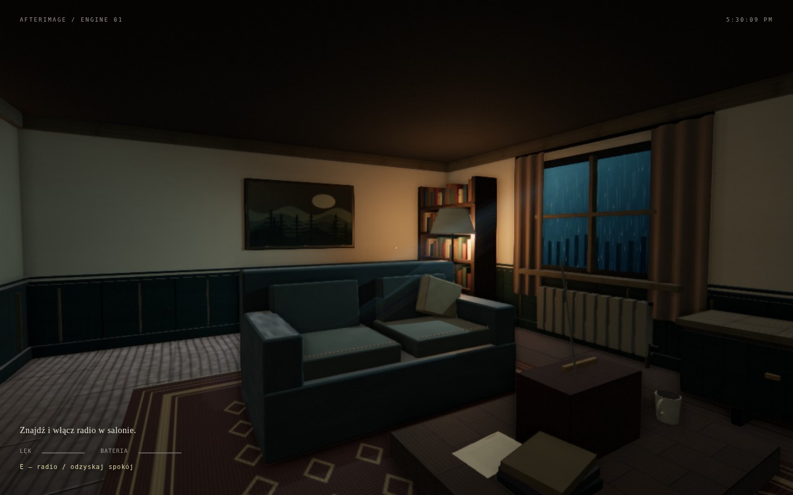
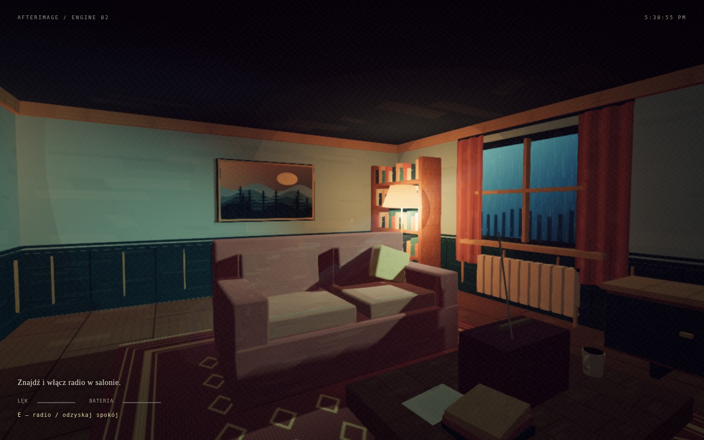

# AFTERIMAGE v2 — laboratorium horroru 3D

Poprawiona i rozbudowana faza 1: dwa samodzielne projekty Three.js. Fazy 2–3 (portale, kamery filmowe, Rapier, teren) nie są jeszcze zaimplementowane. Opcjonalny WebGL2 zależy od wyników poprzednich faz.

## Uruchomienie

Wymagane: Python 3 i aktualny desktopowy Chrome/Firefox/Edge z WebGL2 oraz włączoną akceleracją sprzętową. **Internet nie jest potrzebny do gry.** Bez npm, bundlera i kompilacji. Three.js **0.170.0** i używane oficjalne addons są już w `vendor/three` każdego silnika, z licencją MIT i manifestem sum kontrolnych. Importmap wskazuje lokalne pliki. Modele, tekstury i dźwięki demo powstają proceduralnie.

Pierwsza paczka ładowała bibliotekę z CDN i nie zgłaszała prawidłowo błędów całego grafu importów. v2 usuwa tę zależność sieciową. Klasyczny bootstrap rozpoznaje `file://`, brakujące pliki, błąd inicjalizacji i przekroczenie czasu; pokazuje instrukcję oraz przycisk ponowienia. Nie pozostawia samego „Ładowanie modułów”. Oryginalny wymóg CDN zastąpiono dostarczeniem identycznej, przypiętej biblioteki lokalnie, aby naprawić zawodny start.

[**Pobierz aktualny ZIP v2**](https://github.com/sowieckibartosz02-arch/sca/raw/refs/heads/main/releases/afterimage-phase-1-v2.zip). Rozpakuj **cały** katalog, razem z `vendor`. Nie uruchamiaj plików z podglądu archiwum.

Linux/macOS: `./start.sh` (ewentualnie `sh start.sh`). Windows: `start.bat`. Otwórz w przeglądarce `http://127.0.0.1:8000`. To lokalny adres serwera uruchomionego na Twoim komputerze. Każdy katalog silnika zawiera własne skrypty i może być skopiowany oraz uruchomiony osobno. Zmienna `PORT` zmienia port skryptu Unix. Serwer nie udostępnia plików w sieci LAN. Nie otwieraj przez `file://`.

Po pojawieniu się komunikatu „Gotowe” kliknij przycisk startowy; przeglądarka poprosi o przejęcie myszy. Esc uwalnia mysz i pauzuje. Dźwięk uruchamia się dopiero po geście użytkownika. Brak Pythona jest zgłaszany w oknie skryptu startowego. Windows automatycznie próbuje `py -3`, potem `python`. Jeśli port jest zajęty, zamknij wcześniejszy serwer albo ustaw `PORT`. Gdy przejęcie myszy jest zablokowane, działa WASD i rozglądanie przez przytrzymanie lewego przycisku myszy.

## Nowy wygląd

Przebudowane wnętrza: boazeria, listwy i obramowania drzwi, ramy obrazów, bardziej szczegółowe meble, tkaniny, książki, lampy, dekoracje i dopracowane radio. Twarde powierzchnie mają milimetrowe fazy; miękkie krawędzie pozostają na obiciach. Wyposażenie zachowano i dopracowano w miejscu. Materiały mają spójny rysunek powierzchni oraz normalne wyprowadzone z wysokości, zamiast przypadkowego szumu. Światło okien i ciepłe lampy tworzą oddzielne plany, a detale statyczne są łączone w paczki geometrii.

**PBR** — ciemne stare mieszkanie, lakierowane drewno, chłodne okna, ciepłe oprawy, proceduralne środowisko odbić PMREM, SSAO i subtelny bloom. **Painterly** — ochra, miedź, głęboki petrol, ślady pędzla, kreska i łagodnie modulowana mgła; inna interpretacja tego samego miejsca.




## Sterowanie i przebieg

WASD / mysz, Shift bieg, E interakcja, F latarka, Esc ustawienia, F3 diagnostyka, T test room, klawisz ` konsola, F5 zapis, F9 odczyt. Gamepad: lewy drążek ruch, prawy kamera, A interakcja; kliknięcie nadal wymagane do pointer lock i audio.

Salon jest po lewej stronie korytarza, gabinet po prawej. Radio → klucz w gabinecie → zamknięta sypialnia po lewej na końcu → wspomnienie (18 s pobytu/czasu fabuły) → ostatni sygnał po 180 s aktywnej rozgrywki → przełącznik przy wejściu. Całość trwa zwykle 3–5 min, lecz sygnał celowo wymusza co najmniej 3 min. Radio uspokaja i regeneruje baterię; ciemność zwiększa lęk, 100% lęku kończy grę przegraną. Test room to odizolowany stan w tej samej mapie: przywraca postęp i pozycję po wyjściu, ale ustawienia obrazu pozostają wybrane przez użytkownika.

## Porównanie (wstępne, skala 1–5)

Oceny projektowe, nie pomiary GPU. Dla wydajności, łatwości, dopasowania i rozszerzalności 5 = najlepiej. Dla krzywej nauki 5 = najłatwiej. Dla rozmiaru 5 = najmniejszy koszt; biblioteka jest celowo powielona w samodzielnych katalogach, co zwiększa paczkę, ale umożliwia pracę offline.

| Silnik | Obraz | Wydajność | Tworzenie treści | Psychologiczny horror | Rozszerzalność | Nauka | Rozmiar |
|---|---:|---:|---:|---:|---:|---:|---:|
| 01 PBR | 4 | 2 | 4 | 4 | 4 | 3 | 2 |
| 02 Painterly | 4 | 3 | 4 | 5 | 4 | 4 | 2 |

**01 PBR**: najlepszy punkt wyjścia do wnętrz i survivalu, gdy planujesz dodać dobre modele i mapy PBR. Normal/depth SSAO, bloom i cienie są kosztowne. Proceduralne bryły i małe tekstury nie dają fotorealizmu. Atmosfera używa mgły i efektów przestrzennych; nie jest pełną symulacją rozpraszania z ray marchingiem ani objętościowym cieniem. Światło nie ma pełnego GI.

**02 Painterly**: lepszy wybór do psychologicznej opowieści i zagadek; ograniczona paleta i kreska spajają proste modele. Toon plus renderowane kontury to inna gałąź pipeline'u niż SSAO PBR, ale oba projekty świadomie powielają ten sam kontrakt gameplay, wejścia i audio, aby porównanie było uczciwe. To nie są dwa całkowicie niezależnie zaprojektowane rdzenie. Kontury zwiększają liczbę przebiegów i nie tworzą automatycznie wysokiej jakości rysunku. Mgła pozostaje analityczna, ale shader moduluje ją przestrzennymi smugami; szum papieru działa w postprocessie. To przybliżenie ilustracji, nie symulacja farby.

Do dużego survivalu potrzebna będzie fizyka (#5), do lasu streaming (#6), do filmowego horroru przełączane kamery (#4), do paradoksów przestrzeni portale (#3). Nie zalecam rozbudowy obecnej płaskiej kolizji do tych zastosowań.

## Struktura

```
index.html                  wybór projektu
start.sh / start.bat        serwer całego laboratorium
01-realistic-pbr/           samodzielny projekt
02-painterly/               samodzielny projekt
tools/                      testy developerskie (Python, bez zależności aplikacji)
```

Każdy silnik: `README.md`, `ENGINE_API.md`, własny HTML/CSS, skrypty startowe oraz `src/{bootstrap,main,render,world,decor,materials,input,audio,events,meta}.js` oraz `vendor/three`.

## Weryfikacja i ograniczenia

Wyniki aktualnego uruchomienia znajdują się w `VALIDATION.md`. Testy developerskie mogą używać Playwright, ale aplikacja go nie wymaga. Nie ma żadnego buildu ani instalacji paczek. Opcjonalny `python3 tools/vendor_three.py` odtwarza biblioteki z oficjalnej paczki z kontrolą SHA-512 i zachowaniem TLS; nie jest potrzebny do uruchomienia gry. Repozytorium początkowo było puste; ta faza tworzy pierwszy projekt.

Nie ma multiplayera, navmesha, zapisu obiektów glTF, fizyki schodów ani edytora scen. FPS zależy od GPU, DPR i przeglądarki; adaptacja próbuje osiągnąć 60, nie gwarantuje tego. Progi i wygląd należy sprawdzić na docelowym sprzęcie. Filmowe i crash/loading efekty są wyłącznie fikcją wewnątrz strony. Zapis i pamięć wizyt są lokalne dla origin oraz silnika; przeglądarka może je blokować lub usuwać.
